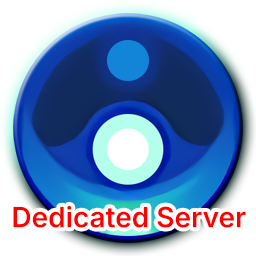
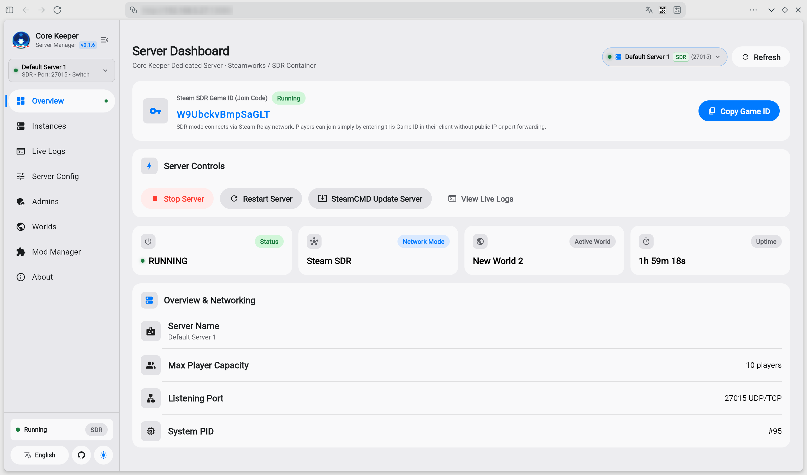
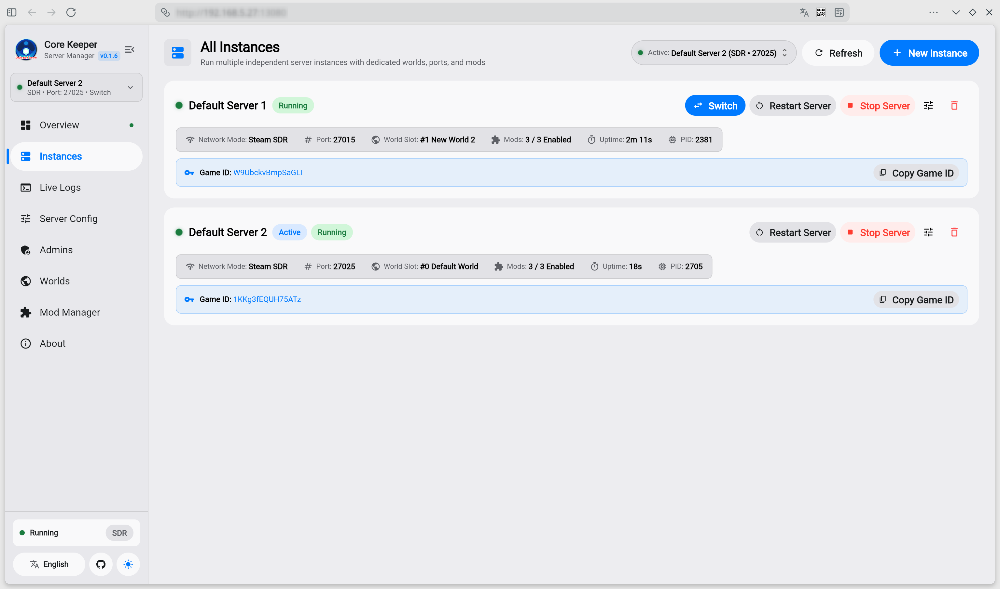
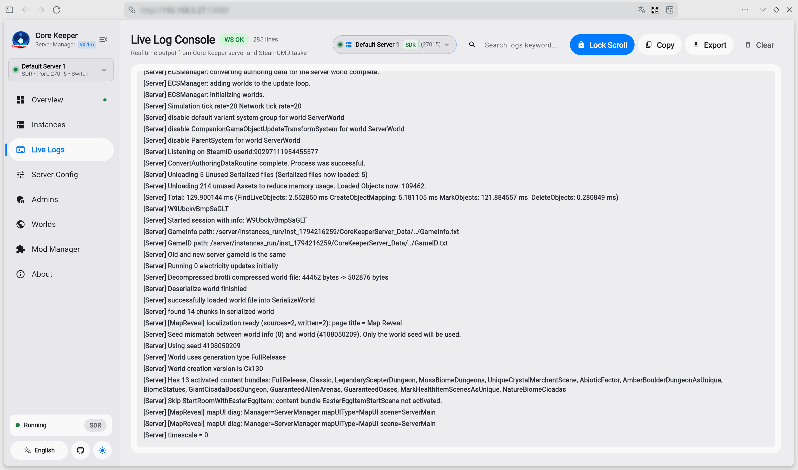
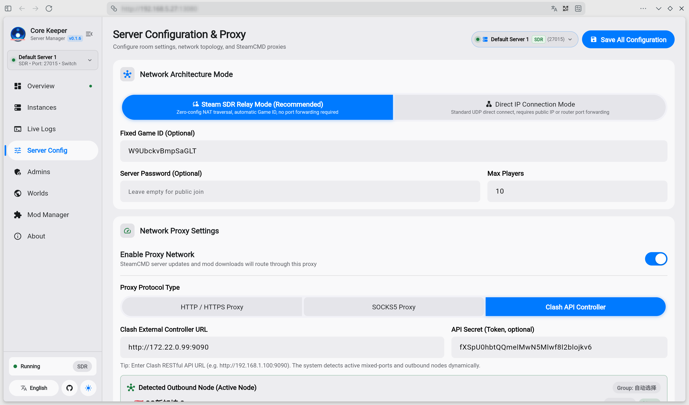
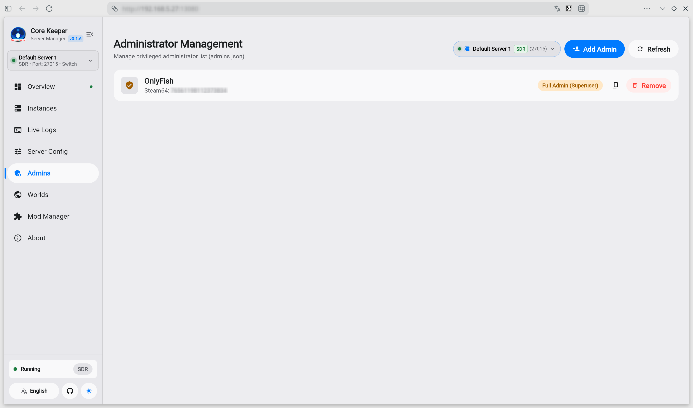
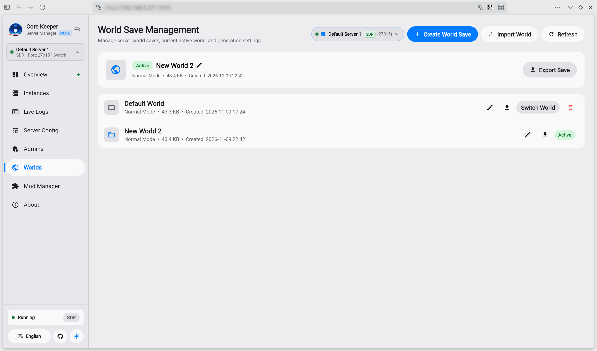
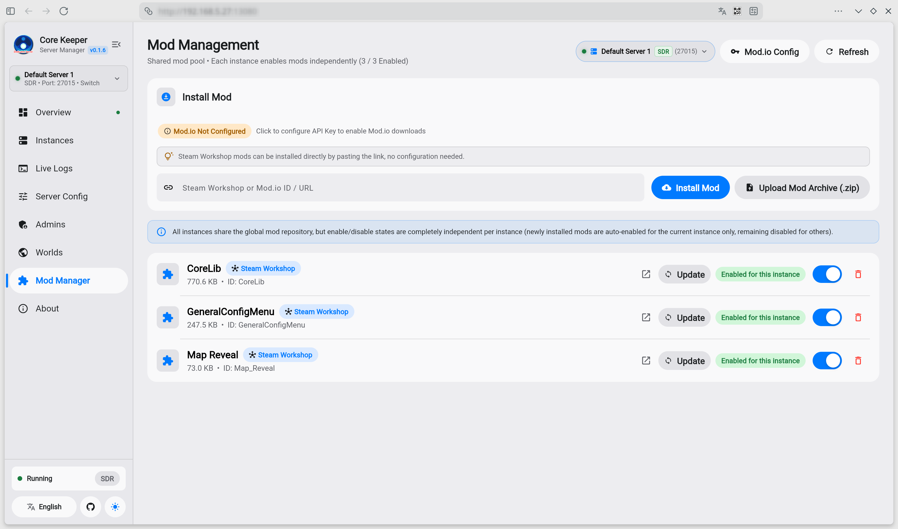
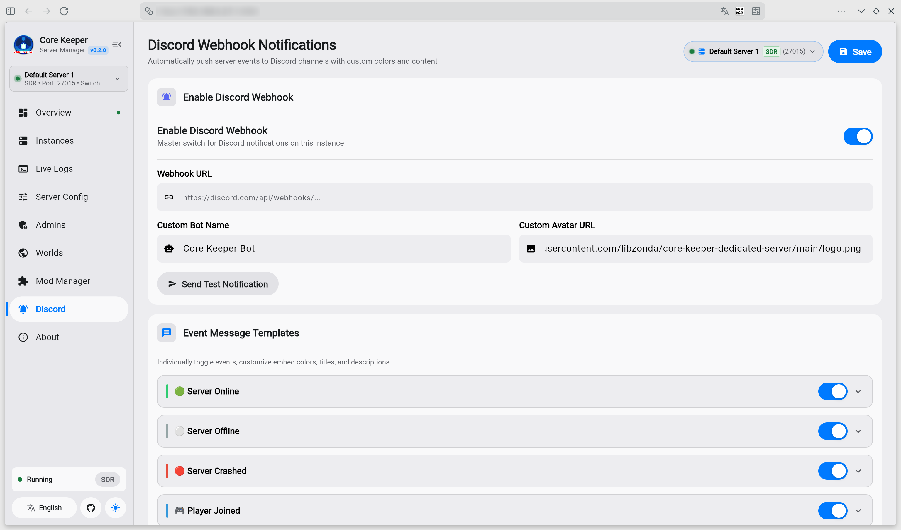

<div align="center">



# Core Keeper Dedicated Server & Web Manager

English | [简体中文](README_zh-CN.md)


[](https://hub.docker.com/r/libzonda/core-keeper-dedicated-server)


An all-in-one, production-ready Docker image for **Core Keeper Dedicated Server**, featuring **Multi-Instance Support**, **Steam SDR relay (no port forwarding required)**, **Direct Connect**, and a modern **Flutter Web management dashboard**.

<br />

[](./screenshots/01_overview.png)

</div>

---

## 🌟 Highlights & Features

- 🖥️ **Full Web Visual Management**: Complete browser-based GUI built with Flutter Web. Control server lifecycle, view real-time WebSocket console logs, configure server parameters, and monitor process metrics with zero terminal operations.
- 🏢 **Multi-Instance Management**: Run multiple isolated server instances simultaneously in a single container. Easily create, switch, start/stop, and configure instances with dedicated worlds, ports, admins, and runtime sandboxes.
- 🚀 **Dual Network Modes (SDR / Direct Connect)**:
  - **Steam SDR (Default)**: Official Steam Datagram Relay. Generates a Game ID on launch—join directly with **no public IP or router port forwarding required**.
  - **Direct Connect**: Traditional UDP direct connection with custom IP, port, and password for LAN or low-latency dedicated hosts.
- 🛡️ **Network Proxy & Clash Integration**: Built-in support for HTTP, SOCKS5, and Clash REST API proxies. Connect your Clash controller to switch nodes on-the-fly and accelerate SteamCMD updates, SDR handshakes, and overseas mod downloads.
- 👑 **In-Game Admin Management**: Visually add, modify, and remove in-game administrators (`Admins.json`) with automatic 17-digit Steam64 ID validation and permission tiers (Superadmin / Admin).
- 🌍 **Multi-World Save Switch, Export & Import**: Manage official world slots (0–29). Switch active worlds on-the-fly, rename saves, import external single-player worlds directly, and export backups (`.world.gzip`) with one click.
- 🧩 **Comprehensive Mod Management (Mods)**:
  - **Steam Workshop**: Paste any Workshop URL or Item ID to install directly—**no configuration required**.
  - **Mod.io Platform**: Built-in Mod.io REST API integration with global API key configuration, supporting mod search, installation via links/slugs, and one-click auto-updates across all instances.
  - **Local Upload**: Upload local `.zip` mod packages with automatic manifest parsing and deployment.
- 🔔 **Discord Webhook Notifications**: Built-in Discord Webhook integration per instance. Real-time notifications for server online/offline, crashes (with error log excerpt), and player join/leave events. Fully customizable embed colors, titles, and message templates with one-click test notification and optional proxy routing support.

---

## 📸 Screenshots

| 🖥️ Server Dashboard & Overview | 🏢 Multi-Instance Management |
| :---: | :---: |
| [](./screenshots/01_overview.png) | [](./screenshots/02_instances.png) |

| 📜 Live Logs & WebSocket Console | ⚙️ Server Configuration & Proxy Settings |
| :---: | :---: |
| [](./screenshots/03_log_track.png) | [](./screenshots/04_server_config.png) |

| 👑 In-Game Admin Management | 🌍 World Save Management & Backup |
| :---: | :---: |
| [](./screenshots/05_admins.png) | [](./screenshots/06_worlds.png) |

| 🧩 Integrated Mod Manager (Steam Workshop & Mod.io) | 🔔 Discord Webhook Notifications |
| :---: | :---: |
| [](./screenshots/07_mod_manager.png) | [](./screenshots/08_discord.png) |

---

## 🚀 Quick Start (Docker Compose)

### 1. docker-compose.yml

Create a `docker-compose.yml` file in your project directory:

```yaml
services:
  core-keeper-server:
    image: libzonda/core-keeper-dedicated-server:latest
    # Or GitHub Container Registry:
    # image: ghcr.io/libzonda/core-keeper-dedicated-server:latest
    container_name: core-keeper-server
    restart: unless-stopped
    ports:
      # Web Management Dashboard
      - "8080:8080"
      # Batch UDP Port Range for Multi-Instance Direct Connect
      # (Reserve ports for instances using Direct Connect, e.g. 27015, 27025, 27035...)
      # In Steam SDR mode, official relay is used so no UDP port forwarding is needed.
      - "27015-27065:27015-27065/udp"
    environment:
      # Web Dashboard Port (Default: 8080)
      - WEB_PORT=8080
    volumes:
      # Persistent storage (all instances, configs, saves, and shared mods)
      - ./server-data:/server/data
      # Game server binaries (auto-downloaded & updated via SteamCMD)
      - ./server-game:/server/game
```

> [!TIP]
> **No per-instance parameters are needed in `docker-compose.yml`!**
> All instance configurations (World Name, Seed, Difficulty, Max Players, Network Mode, Game Port, Admins, and Mods) are created and managed visually in the Web Dashboard. If you exclusively use **Steam SDR mode**, you don't even need to expose any UDP port range.

### 2. Start Container

```bash
docker compose up -d
```

### 3. Access Web Dashboard

Open **`http://<your-server-ip>:8080`** in your browser to manage server instances, view live logs, install mods, and configure worlds.

---

## 🏢 Multi-Instance Setup & Networking

The system supports running multiple server instances concurrently:

1. **Creating Instances**: Go to the **Instances** tab in the Web Dashboard and click **"New Instance"**.
2. **Port Allocation**: When using Direct Connect mode, each instance must use a distinct port (recommended spacing of 10 ports, e.g., `27015`, `27025`, `27035`). Ensure the corresponding UDP port range is mapped in `docker-compose.yml`.
3. **SDR Multi-Instance**: Under SDR mode, each instance automatically generates its own independent **Game ID**. No port conflicts exist in SDR mode.
4. **Shared Mod Pool**: Mods are stored centrally in `server-data/shared_mods` and can be enabled/disabled per instance with a single click.

---

## 🎮 How Players Join

- **Steam SDR (Default & Recommended)**: Copy the **Game ID** from the Web Dashboard. In the Core Keeper game client, choose **Join Game** and paste the Game ID. Works behind NAT/firewalls without port forwarding.
- **Direct Connect**: Ensure UDP ports (e.g. `27015`) are open. Players join by entering `<Server-IP>:<Port>` and server password (if set).

---

## 📂 Directory & File Structure

```text
.
├── docker-compose.yml          # Container configuration
├── logo.png                    # Brand logo
├── server-data/                # Persistent user data (mounted to /server/data)
│   ├── instances.json          # Server instances registry
│   ├── manager_config.json     # Global web manager & proxy configuration
│   ├── shared_mods/            # Shared mod repository pool
│   └── instances/              # Isolated instance directories
│       └── <instance_id>/      # Instance-specific runtime files
│           ├── ServerConfig.json       # Game engine official config
│           ├── manager_config.json     # Instance manager config
│           ├── Admins.json             # Steam admin permissions
│           ├── PlayerBans.json         # Banned players list
│           ├── GameID.txt              # Generated Steam SDR Game ID
│           ├── worlds/                 # World saves (.world.gzip)
│           ├── mods/                   # Active mods symlinks for this instance
│           └── backups/                # Save rollbacks & backups
└── server-game/                # Core Keeper official binaries (mounted to /server/game)
```

---

## ⚙️ Container Environment Variables

Since this manager natively supports multi-instance management, all instance configurations (worlds, difficulty, game ports, passwords, player limits, admins, and mods) as well as proxy and Mod.io configurations are managed visually inside the **Web Dashboard**.

Only the container Web service port can be optionally overridden:

| Variable | Default | Description |
| :--- | :--- | :--- |
| **`WEB_PORT`** | `8080` | Port for the Web management dashboard |

---

## 📄 License

This project is licensed under the [GNU Affero General Public License v3.0 (AGPL-3.0)](LICENSE).
