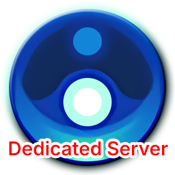
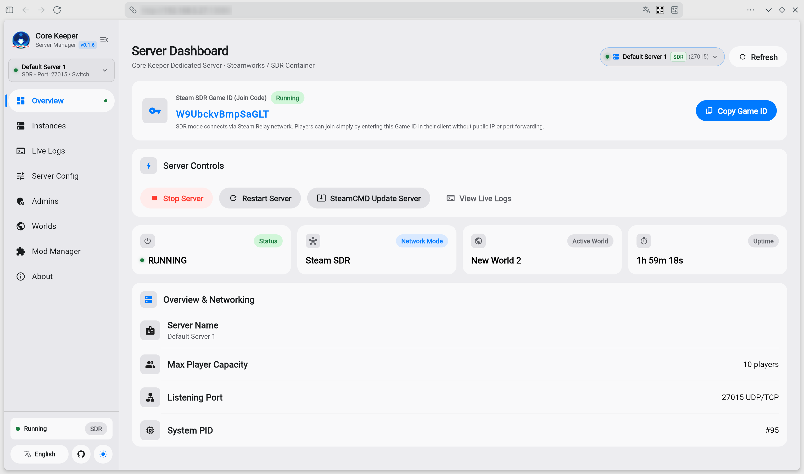
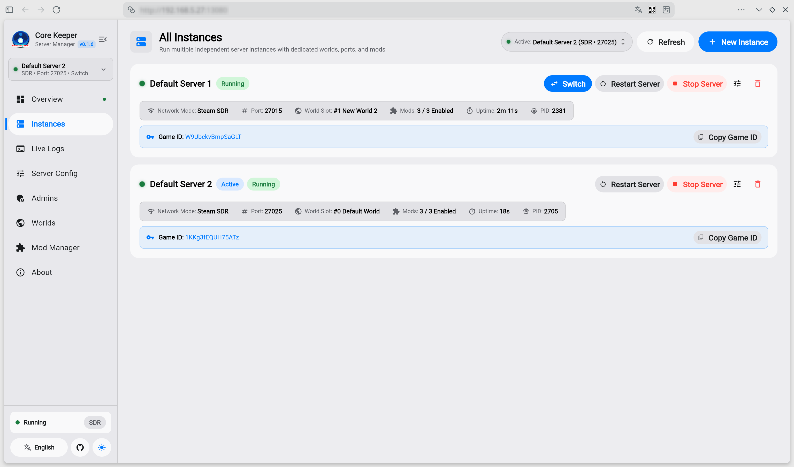
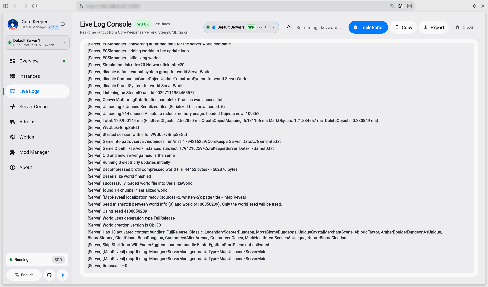
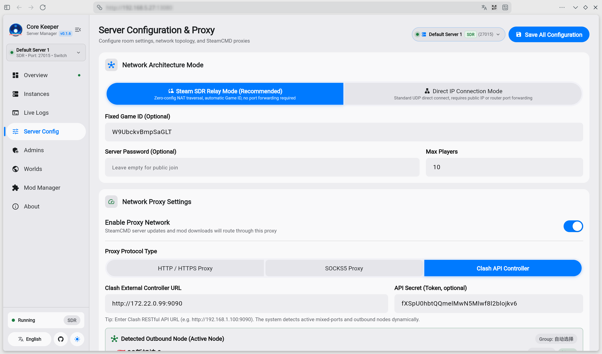
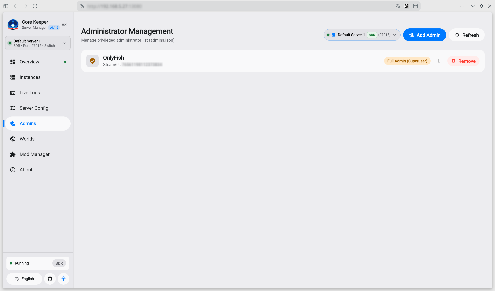
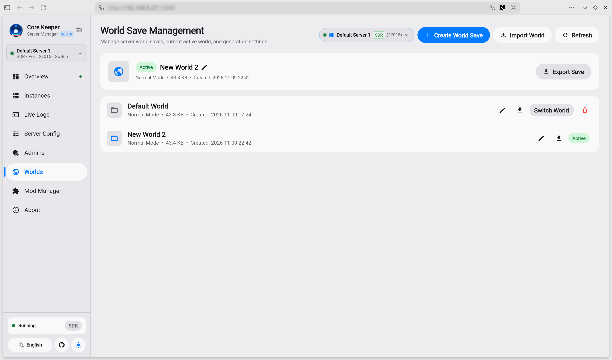
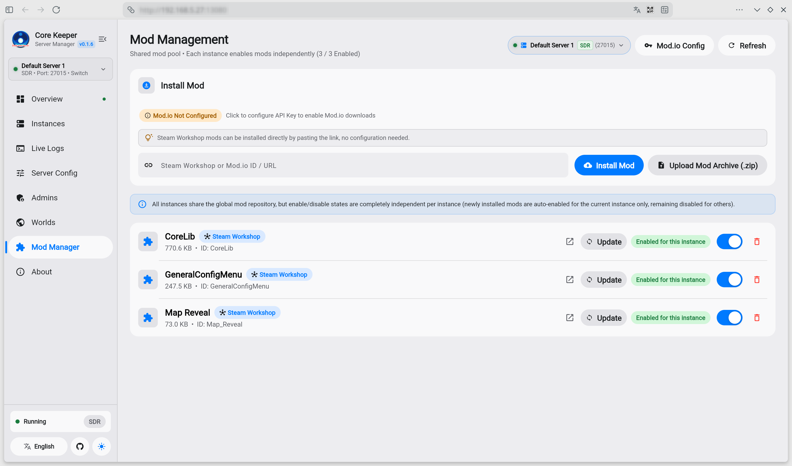

<div align="center">



# Core Keeper Dedicated Server & Web Manager

[](https://github.com/libzonda/core-keeper-dedicated-server)
[](https://hub.docker.com/r/libzonda/core-keeper-dedicated-server)


An all-in-one, production-ready Docker image for **Core Keeper Dedicated Server**, featuring **Multi-Instance Support**, **Steam SDR relay (no port forwarding required)**, **Direct Connect**, and a modern **Flutter Web management dashboard**.

<br />

[](https://raw.githubusercontent.com/libzonda/core-keeper-dedicated-server/main/screenshots/01_overview.png)

</div>

---

## 🌟 Highlights & Features

- 🖥️ **Full Web Visual Management**: Complete browser-based GUI built with Flutter Web. Control server lifecycle, view real-time WebSocket console logs, configure server parameters, and monitor process metrics with zero terminal operations.
- 🏢 **Multi-Instance Management**: Run multiple isolated server instances simultaneously in a single container. Easily create, switch, start/stop, and configure instances with dedicated worlds, ports, admins, and runtime sandboxes.
- 🚀 **Dual Network Modes (SDR / Direct Connect)**:
  - **Steam SDR (Default)**: Official Steam Datagram Relay. Generates a Game ID on launch—join directly with **no public IP or router port forwarding required**.
  - **Direct Connect**: Traditional UDP direct connection with custom IP, port, and password for LAN or low-latency dedicated hosts.
- 🛡️ **Network Proxy & Clash Integration**: Built-in support for HTTP, SOCKS5, and Clash REST API proxies. Connect your Clash controller to switch nodes on-the-fly and accelerate SteamCMD updates, SDR handshakes, and overseas mod downloads.
- 👑 **In-Game Admin Management**: Visually add, modify, and remove in-game administrators (`Admins.json`) with automatic 17-digit Steam64 ID validation and permission tiers (Superadmin / Admin).
- 🌍 **Multi-World Save Switch, Export & Import**: Manage official world slots (0–29). Switch active worlds on-the-fly, rename saves, import external single-player worlds directly, and export backups (`.world.gzip`) with one click.
- 🧩 **Comprehensive Mod Management (Mods)**:
  - **Steam Workshop**: Paste any Workshop URL or Item ID to install directly—**no configuration required**.
  - **Mod.io Platform**: Built-in Mod.io REST API integration with global API key configuration, supporting mod search, installation via links/slugs, and one-click auto-updates across all instances.
  - **Local Upload**: Upload local `.zip` mod packages with automatic manifest parsing and deployment.

---

## 📸 Screenshots

| 🖥️ Server Dashboard & Overview | 🏢 Multi-Instance Management |
| :---: | :---: |
| [](https://raw.githubusercontent.com/libzonda/core-keeper-dedicated-server/main/screenshots/01_overview.png) | [](https://raw.githubusercontent.com/libzonda/core-keeper-dedicated-server/main/screenshots/02_instances.png) |

| 📜 Live Logs & WebSocket Console | ⚙️ Server Configuration & Proxy Settings |
| :---: | :---: |
| [](https://raw.githubusercontent.com/libzonda/core-keeper-dedicated-server/main/screenshots/03_log_track.png) | [](https://raw.githubusercontent.com/libzonda/core-keeper-dedicated-server/main/screenshots/04_server_config.png) |

| 👑 In-Game Admin Management | 🌍 World Save Management & Backup |
| :---: | :---: |
| [](https://raw.githubusercontent.com/libzonda/core-keeper-dedicated-server/main/screenshots/05_admins.png) | [](https://raw.githubusercontent.com/libzonda/core-keeper-dedicated-server/main/screenshots/06_worlds.png) |

| 🧩 Integrated Mod Manager (Steam Workshop & Mod.io) |
| :---: |
| [](https://raw.githubusercontent.com/libzonda/core-keeper-dedicated-server/main/screenshots/07_mod_manager.png) |

---

## 🚀 Quick Start (Docker Compose)

Create a `docker-compose.yml` file in your project directory:

```yaml
services:
  core-keeper-server:
    image: libzonda/core-keeper-dedicated-server:latest
    # Or use GitHub Container Registry:
    # image: ghcr.io/libzonda/core-keeper-dedicated-server:latest
    container_name: core-keeper-server
    restart: unless-stopped
    ports:
      # Web Management Dashboard
      - "8080:8080"
      # Batch UDP Port Range for Multi-Instance Direct Connect
      # (Reserve ports for instances using Direct Connect, e.g. 27015, 27025, 27035...)
      # In Steam SDR mode, official relay is used so no UDP port forwarding is needed.
      - "27015-27065:27015-27065/udp"
    environment:
      # Web Dashboard Port (Default: 8080)
      - WEB_PORT=8080
    volumes:
      # Persistent storage (all instances, configs, saves, and shared mods)
      - ./server-data:/server/data
      # Game server binaries (auto-downloaded & updated via SteamCMD)
      - ./server-game:/server/game
```

> **Tip:** You do not need to configure any game instance parameters in `docker-compose.yml`. All settings (World Name, Seed, Difficulty, Max Players, Network Mode, Game Port, Admins, and Mods) are created and managed visually in the Web Dashboard. If you exclusively use **Steam SDR mode**, you don't even need to expose any UDP port range.

### Start the Server

```bash
docker compose up -d
```

### Access Web Dashboard

Open **`http://<your-server-ip>:8080`** in your browser.

---

## 📂 Volume Mounts & Directory Structure

| Host Path | Container Path | Description |
|---|---|---|
| `./server-data` | `/server/data` | Stores all instance metadata, world save files (`.world.gzip`), admin configs, proxy settings, and shared mod pool. |
| `./server-game` | `/server/game` | Core Keeper Dedicated Server binaries automatically downloaded and updated by SteamCMD. |

---

## 🌐 Networking Modes

### 1. Steam SDR Mode (Default & Recommended)
- **Zero port forwarding needed**: Works seamlessly behind NAT, CGNAT, or mobile networks.
- Simply copy the **Game ID** generated on the Web Dashboard. Players join directly by entering the Game ID in the Core Keeper client.

### 2. Direct Connect Mode (For Dedicated / Low-Latency Networks)
- Requires exposing container UDP ports (e.g. `27015:27015/udp`).
- Players join directly using `<Your-Server-IP>:<Port>` and password (if set).

---

## 🔗 Links & Documentation

- **GitHub Repository**: [https://github.com/libzonda/core-keeper-dedicated-server](https://github.com/libzonda/core-keeper-dedicated-server)
- **English README**: [README.md](https://github.com/libzonda/core-keeper-dedicated-server/blob/main/README.md)
- **Chinese Documentation (简体中文)**: [README_zh-CN.md](https://github.com/libzonda/core-keeper-dedicated-server/blob/main/README_zh-CN.md)
- **Issue Tracker**: [https://github.com/libzonda/core-keeper-dedicated-server/issues](https://github.com/libzonda/core-keeper-dedicated-server/issues)

---

## 📄 License

This project is licensed under the [GNU Affero General Public License v3.0 (AGPL-3.0)](https://github.com/libzonda/core-keeper-dedicated-server/blob/main/LICENSE).

