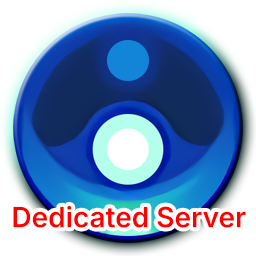

<div align="center">



# Core Keeper 专用服务端与 Web 管理器

[English](README.md) | 简体中文


专为 **地心护核者 (Core Keeper)** 打造的高性能全功能 Docker 部署镜像。<br/>
原生集成 **多实例并发管理**、**Steam SDR 免公网穿透中继**、**直链联机** 以及基于 **Flutter Web** 的现代管理控制台。

</div>

---

## 🌟 核心特性 (Features)

- 🖥️ **Web 完全可视化管理**：基于 Flutter Web 打造的现代化图形管理后台，全流程浏览器可视化操作，涵盖进程生命周期启停、毫秒级 WebSocket 实时日志流、参数调优与运行监控。
- 🏢 **多实例并发管理**：单容器内原生支持同时运行多个独立的游戏服务端实例，各实例拥有独立世界存档、端口分配、管理员名单与隔离运行沙盒，支持一键创建与平滑切换。
- 🚀 **SDR / 直链 双网络模式**：
  - **Steam SDR (默认推荐)**：原生集成官方数据报中继协议，启动自动提取 Game ID，玩家凭码秒连，**无需公网 IP 与路由器端口映射**。
  - **直链模式 (Direct Connect)**：支持自定义 IP、端口与进入密码，适配内网局域网或低延迟专用服务器。
- 🛡️ **网络代理配置与 Clash 接入**：内置 HTTP、SOCKS5 代理支持，并深度整合 Clash REST API 控制器。支持在线测速、切换代理节点，彻底解决国内服务器拉取 SteamCMD 更新、SDR 握手与外网模组下载慢的问题。
- 👑 **服务器管理员配置 (游戏内管理员)**：可视化维护游戏内特权管理员名单（`Admins.json`），自动校验 17 位 Steam64 ID，支持超级管理员（Superadmin）与协管员权限分级管理。
- 🌍 **多存档切换、导入与导出**：完整支持官方 0~29 号世界槽位。随时切换运行世界、在线重命名，支持单机世界存档一键上传导入以及在线打包导出备份（`.world.gzip`）。
- 🧩 **MOD 模组全能管理**：
  - **Steam 创意工坊**：直接粘贴工坊链接或工坊 ID 即可自动下载安装，**无需任何配置**。
  - **Mod.io 平台集成**：内置 Mod.io REST API 支持，在模组页配置全局 API Key 后，全实例均可直接解析链接/Slug 下载并支持全实例同步在线升级。
  - **本地上传**：支持直接上传本地 `.zip` 模组压缩包自动解压并补全清单部署。

---

## 🚀 快速开始 (Docker Compose)

### 1. docker-compose.yml

在项目目录中创建 `docker-compose.yml` 文件：

```yaml
services:
  core-keeper-server:
    image: libzonda/core-keeper-dedicated-server:latest
    # 或使用 GitHub Container Registry 镜像:
    # image: ghcr.io/libzonda/core-keeper-dedicated-server:latest
    container_name: core-keeper-server
    restart: unless-stopped
    ports:
      # Web 管理后台端口 (Web Dashboard)
      - "8080:8080"
      # 直链模式批量预留 UDP 端口段 (供多实例并发直链使用，如 27015, 27025, 27035...)
      # Steam SDR 模式通过官方中继连接，免端口映射；若仅用 SDR 可注释此段
      - "27015-27065:27015-27065/udp"
    environment:
      # Web 控制台服务端口 (可选，默认 8080)
      - WEB_PORT=8080
    volumes:
      # 持久化存储所有实例列表、独立存档、配置文件与共享模组
      - ./server-data:/server/data
      # 游戏服务端二进制文件 (SteamCMD 自动下载维护)
      - ./server-game:/server/game
```

> [!TIP]
> **无需在 `docker-compose.yml` 中配置任何游戏实例参数！**  
> 所有实例的名称、世界存档、种子、难度、人数上限、直链/SDR模式、监听端口、管理员与模组，均在 Web 可视化后台中按需创建和管理。若仅使用 **Steam SDR 模式**，甚至无需映射任何 UDP 端口段。

### 2. 启动容器

```bash
docker compose up -d
```

### 3. 访问 Web 控制台

在浏览器中打开 **`http://<服务器IP>:8080`** 即可进入后台管理各实例、查看日志与管理模组。

---

## 🏢 多实例配置与网络规划

系统支持单容器并发托管多个游戏世界与实例：

1. **创建实例**：在 Web 控制台左侧点击 **「实例管理」** ➔ **「创建实例」**。
2. **端口隔离**：若使用直链模式，每个实例需分配不同的游戏端口（如 `27015`、`27025`、`27035`），并确保该端口已包含在 `docker-compose.yml` 的 UDP 映射段内。
3. **SDR 多实例**：若使用 SDR 模式，每个实例独立生成独立的 **Game ID**，无需开放端口，亦不存在端口冲突。
4. **共享模组池**：所有模组统一保存在 `server-data/shared_mods`，可在各个实例中独立一键开启或关闭。

---

## 🎮 玩家如何加入游戏

- **Steam SDR 模式 (默认推荐)**：启动实例后，直接在 Web 控制台复制 **Game ID**。玩家在《地心护核者》客户端中点击 **「加入游戏」** ➔ 粘贴 Game ID 即可加入，大内网穿透秒连。
- **直链模式 (Direct Connect)**：需确保服务器防火墙开放了对应 UDP 端口。玩家在客户端输入 `<服务器IP>:<端口>` 及密码（若有）进行连接。

---

## 📂 文件与目录结构说明

```text
.
├── docker-compose.yml          # Docker Compose 编排文件
├── logo.png                    # 项目标志图
├── server-data/                # 宿主机持久化数据目录 (挂载至 /server/data)
│   ├── instances.json          # 所有实例元数据与活跃实例注册表
│   ├── manager_config.json     # 全局配置与代理设置 (含 Mod.io API Key)
│   ├── shared_mods/            # 全局共享模组文件池
│   └── instances/              # 独立实例数据目录
│       └── <instance_id>/      # 专属实例运行时目录
│           ├── ServerConfig.json       # 官方游戏服务端配置
│           ├── manager_config.json     # 实例特定配置
│           ├── Admins.json             # 管理员名单 (Steam64 ID)
│           ├── PlayerBans.json         # 玩家封禁名单
│           ├── GameID.txt              # 当前运行生成的 SDR Game ID
│           ├── worlds/                 # 该实例的世界存档 (.world.gzip)
│           ├── mods/                   # 实例启用的模组软链接目录
│           └── backups/                # 历史备份与回滚目录
└── server-game/                # Core Keeper 服务端程序文件 (挂载至 /server/game)
```

---

## ⚙️ 容器运行环境变量

由于本项目采用原生多实例架构，所有游戏实例参数（世界存档、难度模式、端口、密码、人数上限、管理员、模组等）以及网络代理配置、Mod.io 授权均在 **Web 控制台** 中直观配置。

`docker-compose.yml` 仅支持按需覆盖以下容器服务端口：

| 环境变量 | 默认值 | 说明 |
| :--- | :--- | :--- |
| **`WEB_PORT`** | `8080` | Web 管理后台访问端口 |

---

## 📄 开源许可证 (License)

本项目基于 [GNU Affero General Public License v3.0 (AGPL-3.0)](LICENSE) 开源。

